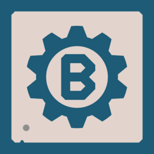

<p align="center"></p>

<h1 align="center">PS2BUILD</h1>

ps2build builds PlayStation 2 homebrew. A single `ps2.yaml` describes your EE and IOP targets; ps2build produces the build, IDE metadata and installable packages, and keeps the PS2 SDK and toolchain up to date.

Documentation: [ps2build.dev](https://ps2build.dev).

## Install

Linux and macOS:

```
curl -sSfL https://ps2build.dev/install.sh | sh
```

Windows (PowerShell):

```
irm https://ps2build.dev/install.ps1 | iex
```

This installs ps2build and runs `ps2build update` to fetch the toolchain and SDK. Binaries are also on the [releases page](https://github.com/ps2build/ps2build/releases).

## Usage

```
ps2build init my-game      # scaffold a project
cd my-game
ps2build build             # build it
ps2build explain           # ps2.yaml reference and examples
ps2build schema            # JSON Schema for editor completion
```

| Command | Purpose |
|---|---|
| `init` | Scaffold a new project. |
| `build` | Build the project. |
| `generate` | Prepare a project for building without building it. |
| `install` | Build the project and install its packages into the SDK. |
| `update` | Install or update the SDK, toolchains and tools. |
| `validate` | Check generated compile commands for common problems. |
| `mcp` | Run an MCP server exposing installed packages and `ps2.yaml` tooling. |
| `version` | Print the ps2build and installed component versions. |

Target types are `ee`, `iop`, `ee_lib` and `iop_lib`. Both the GCC and LLVM toolchains are supported.

## Development

```
go build ./...
go test ./...
```

See [docs/ARCHITECTURE.md](docs/ARCHITECTURE.md) and [CONTRIBUTING.md](CONTRIBUTING.md).

## License

CC0 1.0 Universal. See [LICENSE](LICENSE). Third-party licenses are in [licenses/](licenses/).
